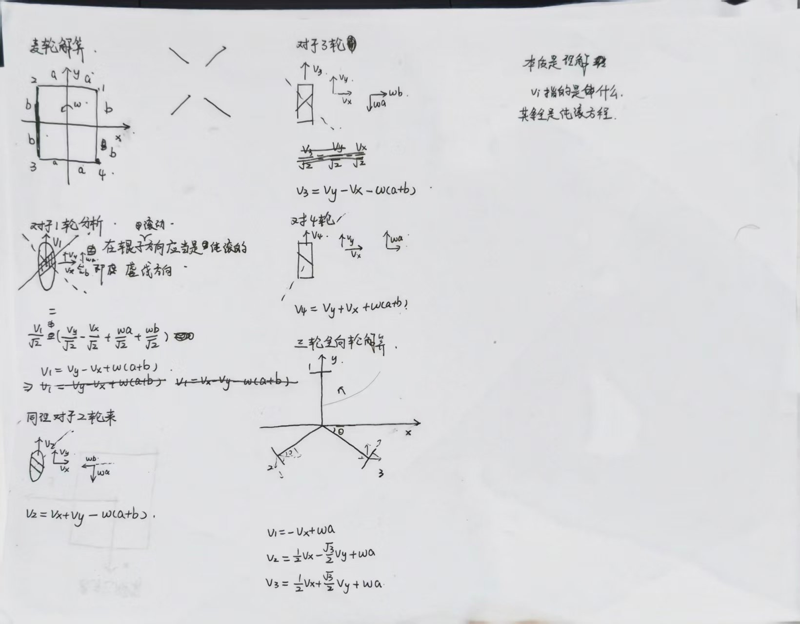

# 底盘解算

> 必做记录（README「学习-文档作业」）。要求写清**推导过程与自己的理解**，而不是只贴结论。
> 现状：骨架已列好，各节的推导待我自己补写。

## 0. 符号与约定

| 符号 | 含义 |
| --- | --- |
| $v_x, v_y$ | 底盘平移速度（$x$ 向前、$y$ 向左） |
| $\omega_z$ | 底盘自转角速度（逆时针为正） |
| $v_i$ | 第 $i$ 个轮子的线速度（沿其驱动力方向） |
| $a, b$ | 轮子安装位置到中心的纵向 / 横向距离 |

轮子编号（俯视图，待按实际构型确认）：

```
        前
   1 ──────── 2
   │          │
   │          │
   4 ──────── 3
        后
```

> 讨论中先忽略轮径与减速比，得到轮子**线速度**后再统一换算到电机转速。

## 1. 麦克纳姆轮

### 1.1 辊子排布与受力方向

- 辊子与轮轴成 45° 时，轮子能提供哪个方向的驱动力？哪个方向是自由滑动方向？
- O 型排布与 X 型排布差在哪里？两种排布下四个轮子的受力方向分别是什么？

（配简图说明。）

### 1.2 由底盘速度推导单个轮子的线速度

- 轮子中心处的速度由哪几部分组成（平动 + 自转）？
- 这个速度向量沿「辊子自由滑动方向」和「驱动力方向」分解，哪一部分才真正让轮子转动？
- 由此写出 $v_i$ 的表达式。

我的推导（手写，逐箭头投影后求和）：



> 照片内容：**左半**＝麦轮逐轮分析（1～4 轮，把轮心速度拆成 $v_x$、$v_y$、$\omega a$、$\omega b$ 四个箭头，分别投影到辊子轴线方向后求和）；**右半**＝三轮全向轮解算。

### 1.3 逆解算

$$ \begin{bmatrix} v_1 \\ v_2 \\ v_3 \\ v_4 \end{bmatrix} = \begin{bmatrix} \cdots \end{bmatrix} \begin{bmatrix} v_x \\ v_y \\ \omega_z \end{bmatrix} $$

逐项说明每个系数的来源（哪个几何量、哪个投影带来的）。

### 1.4 正解算

由 $v_1 \sim v_4$ 反推 $v_x, v_y, \omega_z$，并说明该矩阵与逆解算矩阵的关系。

### 1.5 代入实际参数

轮径、减速比、电机转速单位（rpm / rad/s）→ 整理成可直接写进代码的换算关系。

## 2. 全向轮

- 辊子与轮轴垂直（90°）时，与麦轮的差别在哪里？
- 三轮 / 四轮全向构型的解算推导。

三轮全向（三轮回转 120°）的解算已写在 §1.2 的手写照片**右半部分**。

## 3. 舵轮

### 3.1 舵向电机与舵轮电机的分工

### 3.2 逆解算推导

由 $v_x, v_y, \omega_z$ 求每个舵轮的舵向角 $\theta_i$ 与轮速 $v_i$。

### 3.3 角度归一化与象限判断

$\operatorname{atan2}$ 的取值范围、如何映射到舵机的机械行程。

### 3.4 工程优化：避免舵轮频繁翻转

舵轮角度解与「角度加 180°、速度取反」等价，如何选代价最小的那个？

## 4. 功率计算（选做）

- 电机功率的近似公式是怎么来的？
- 用什么方法、采哪些数据来标定公式中的常数？
- 不同轮组分别在什么场景下有优势？半舵半全向的构型为什么存在？

## 5. 参考资料

1. 待补充
